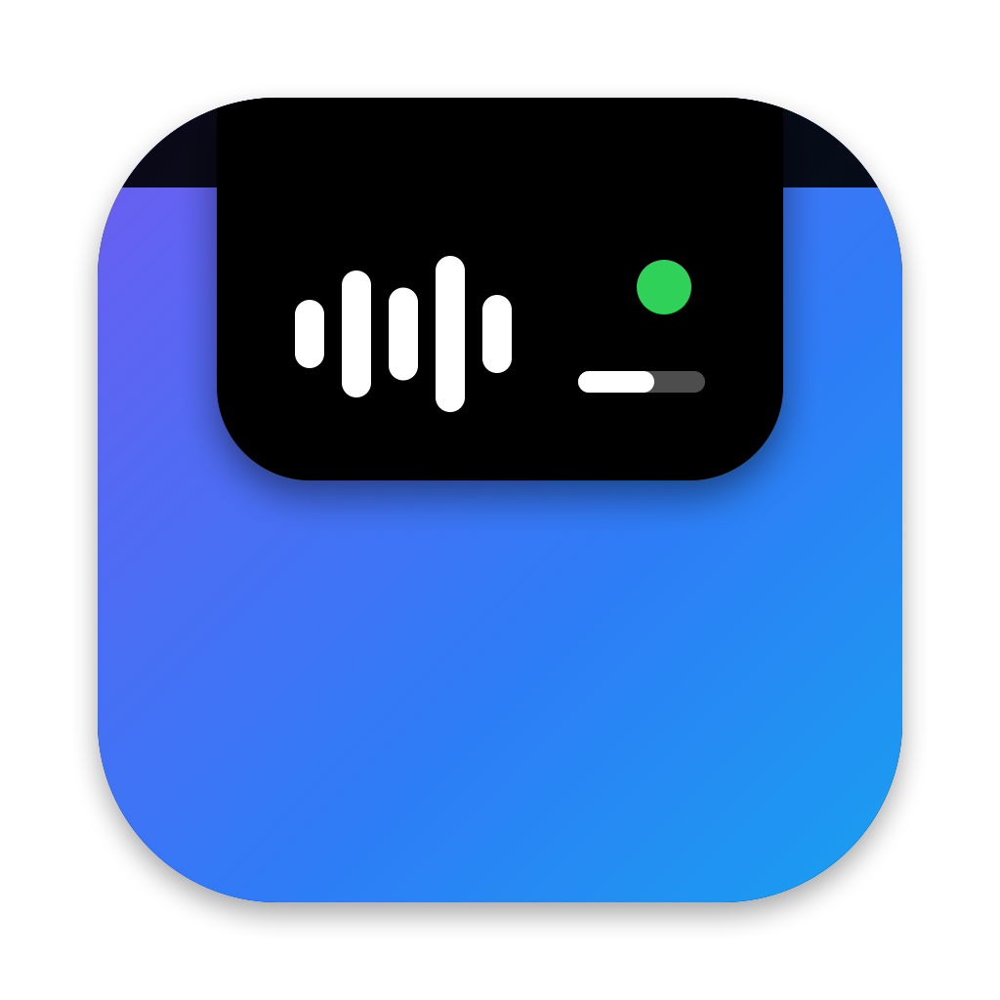

# NotchFlow

Convierte el notch de los MacBook en un centro de control compacto: música,
calendario, aplicaciones favoritas, estado del sistema y actividad reciente.
En reposo queda oculto tras el notch; al pasar el cursor o hacer clic se
despliega un panel.



## Requisitos

**Para usarla**

- MacBook con notch (todos son Apple Silicon: Air M2 en adelante, Pro de 14 y
  16 pulgadas desde 2021). En otras pantallas funciona como una zona invisible
  en el centro de la barra de menús.
- macOS 14 Sonoma o posterior.

**Para compilarla**

- Command Line Tools de Xcode con Swift 6 (`xcode-select --install`), o Xcode 16
  o posterior. No necesita dependencias externas ni CMake.

## Compilar y ejecutar

```sh
Scripts/build-app.sh            # crea build/NotchFlow.app (release)
open build/NotchFlow.app
Scripts/test.sh                 # pruebas unitarias
```

La app no aparece en el Dock. Se controla desde su icono en la barra de menús
(abrir el panel, Configuración, Salir).

### Con Xcode

Abre `Package.swift` en Xcode para editar el código y ejecutar las pruebas
(⌘U). Para **ejecutar la app** usa `Scripts/build-app.sh`: desde Xcode se
lanzaría el ejecutable sin su paquete `.app`, es decir, sin `Info.plist` (macOS
cierra la app al pedir el calendario si falta el texto que explica el permiso),
sin icono y sin el adaptador de música.

### Ayudas de desarrollo

- `open build/NotchFlow.app --args -debugExpand YES` abre el panel al arrancar.
- Registros de diagnóstico (sin títulos de canciones ni de eventos):
  `log stream --info --predicate 'subsystem == "com.axeldiaz.notchflow"'`

## Funciones

| Módulo | Qué hace | Cómo |
|---|---|---|
| Música | Título, artista, carátula, progreso y controles de **cualquier reproductor** (navegadores, Música, Spotify…) | MediaRemote mediante mediaremote-adapter; respaldo con Apple Music por Apple Events |
| Calendario | Evento en curso o próximo con cuenta atrás y eventos de los próximos 7 días | EventKit |
| Aplicaciones | Accesos directos a tus apps favoritas, con indicador de app abierta | NSWorkspace |
| Accesos rápidos | Volumen (ajustable), batería y Wi-Fi (estado); brillo y Bluetooth (enlace a Ajustes) | CoreAudio, IOKit, CoreWLAN |
| Actividad | Avisos de la propia app: evento próximo, cambio de canción, batería | — |

Junto al notch aparecen indicadores cuando hay actividad: música sonando, un
evento en 30 minutos o menos, batería baja.

**Lo que macOS no permite y la app no simula:** trasladar los iconos de otras
apps de la barra de menús, leer las notificaciones de otras apps, ajustar el
brillo o encender el Bluetooth.

## Permisos y privacidad

| Permiso | Cuándo se pide | Para qué |
|---|---|---|
| Calendarios | Al pulsar "Permitir acceso" en la tarjeta de calendario | Leer tus eventos |
| Automatización de Música | Solo si MediaRemote deja de funcionar y se usa el respaldo | Leer y controlar Música |

No hay red, telemetría ni cuentas. Las preferencias se guardan en
`UserDefaults` del propio Mac. La actividad reciente vive solo en memoria.

### API privada: MediaRemote

macOS no ofrece una API pública para saber qué suena en el sistema. El módulo
de música usa el framework privado MediaRemote a través de
[mediaremote-adapter](Vendor/mediaremote-adapter/VENDORED.md), incluido en el
proyecto. Es la **única** API privada de NotchFlow, aceptada a sabiendas de que:

- Apple puede bloquearla en cualquier actualización de macOS. En ese caso la app
  lo detecta y pasa a Apple Music sola.
- Impide publicar en la Mac App Store (tampoco sería posible por el sandbox).

## Cambiar el nombre o el identificador

Todo está en `Config/app.env` (`APP_NAME`, `BUNDLE_ID`, versión). Los módulos
de código tienen nombres neutros y no hay que tocarlos. Cambiar `BUNDLE_ID`
hace que macOS trate la app como nueva: se pierden las preferencias y los
permisos concedidos.

## Versión de prueba

```sh
Scripts/package.sh
```

Crea `dist/NotchFlow-<versión>.zip` y `.dmg`. Antes de cada entrega sube
`APP_VERSION` y `APP_BUILD` en `Config/app.env`.

## Firma y distribución

Hay tres niveles, de menos a más preparado:

| Cómo se genera | Quién puede abrirla | Qué ve el usuario |
|---|---|---|
| `Scripts/build-app.sh` (firma ad-hoc, por defecto) | Solo este Mac | Nada. Pero macOS puede volver a pedir los permisos tras cada recompilación |
| Firmada con **Developer ID**, sin notarizar | Cualquier Mac, con un paso manual | "No se puede verificar que esté libre de malware". Hay que ir a Ajustes del Sistema > Privacidad y seguridad > **Abrir igualmente** (desde macOS 15, el clic derecho > Abrir ya no basta) |
| Firmada con Developer ID **y notarizada** | Cualquier Mac | Solo el aviso estándar de "descargada de Internet" |

Una app con firma ad-hoc compartida con otra persona se trata como no firmada:
Gatekeeper la bloquea (comprobado con `spctl`). Un usuario técnico puede
quitarle la cuarentena con `xattr -dr com.apple.quarantine NotchFlow.app`,
asumiendo el riesgo.

### Instalar una versión sin firmar

Las versiones que genera GitHub Actions (y `Scripts/package.sh` sin
`SIGN_IDENTITY`) llevan firma ad-hoc, no un certificado de Apple. Se pueden
instalar como cualquier app desconocida:

1. Abre el `.dmg` y arrastra **NotchFlow** a **Aplicaciones**. Ábrela siempre
   desde Aplicaciones: desde el `.dmg` o Descargas, macOS la ejecuta desde una
   ubicación temporal y "Abrir al iniciar sesión" no funciona.
2. Ábrela. macOS dirá que no puede verificar que esté libre de malware: pulsa
   **Aceptar** (no "Trasladar a la Papelera").
3. Ve a **Ajustes del Sistema > Privacidad y seguridad**, baja hasta
   *Seguridad* y pulsa **Abrir igualmente** junto al aviso de NotchFlow.
   Confirma con tu contraseña.
4. Solo hace falta la primera vez. Con cada versión nueva macOS volverá a
   pedir el permiso del calendario.

Alternativa para usuarios técnicos, con el mismo efecto:
`xattr -dr com.apple.quarantine /Applications/NotchFlow.app`

### Publicar una versión con GitHub Actions

`.github/workflows/release.yml` compila, prueba y empaqueta en una máquina
macOS de GitHub:

```sh
# 1. Sube APP_VERSION y APP_BUILD en Config/app.env y haz commit.
# 2. Crea y sube la etiqueta con la misma versión:
git tag v0.1.0
git push origin v0.1.0
```

El flujo comprueba que la etiqueta coincide con `APP_VERSION` y publica una
Release con el `.dmg` y el `.zip`. También se puede lanzar a mano desde la
pestaña *Actions* para obtener los archivos sin publicar nada.

### Firma estable para desarrollo

Para que macOS no olvide los permisos en cada compilación basta una identidad
de firma estable. Sin cuenta de desarrollador, crea un certificado local:

1. Acceso a Llaveros > Asistente para certificados > Crear un certificado.
2. Nombre `NotchFlow Local`, tipo de identidad "Raíz autofirmada", tipo de
   certificado "Firma de código".
3. `SIGN_IDENTITY="NotchFlow Local" Scripts/build-app.sh`

Solo sirve en tu Mac; no evita los avisos de Gatekeeper en otros equipos.

### Distribución con Developer ID y notarización

Requiere el Apple Developer Program (de pago, anual).

1. Crea un certificado **Developer ID Application** (Xcode > Ajustes >
   Cuentas > Gestionar certificados, o en developer.apple.com) y comprueba que
   está en el llavero:
   `security find-identity -v -p codesigning`
2. Guarda las credenciales de notarización en el llavero, una sola vez. Usa una
   contraseña de app de appleid.apple.com, nunca la contraseña de tu cuenta, y
   no la guardes en el proyecto:
   ```sh
   xcrun notarytool store-credentials "notchflow-notary" --apple-id TU_APPLE_ID --team-id TU_TEAM_ID
   ```
3. Firma y empaqueta:
   ```sh
   SIGN_IDENTITY="Developer ID Application: Tu Nombre (TEAMID)" Scripts/package.sh
   ```
4. Notariza y grapa el `.dmg`, que es lo que se distribuye:
   ```sh
   Scripts/notarize.sh dist/NotchFlow-0.1.0.dmg
   ```

La firma activa Hardened Runtime con dos excepciones declaradas en
`Config/NotchApp.entitlements`: calendarios y Apple Events. El framework del
adaptador se firma con la misma identidad.

## Desinstalar

1. Desactiva "Abrir al iniciar sesión" en Configuración y sal de la app.
2. Borra `NotchFlow.app`.
3. Opcional, para borrar preferencias y permisos:
   ```sh
   defaults delete com.axeldiaz.notchflow
   tccutil reset All com.axeldiaz.notchflow
   ```

## Documentación

- [Arquitectura y decisiones técnicas](docs/ARCHITECTURE.md)
- [Pruebas y estabilización](docs/TESTING.md)

## Licencias de terceros

- **mediaremote-adapter** de Jonas van den Berg y colaboradores, licencia
  BSD 3-Clause. Copia en `Vendor/mediaremote-adapter/LICENSE`; también se
  incluye dentro de la app (`Contents/Resources/mediaremote-adapter-LICENSE.txt`).
